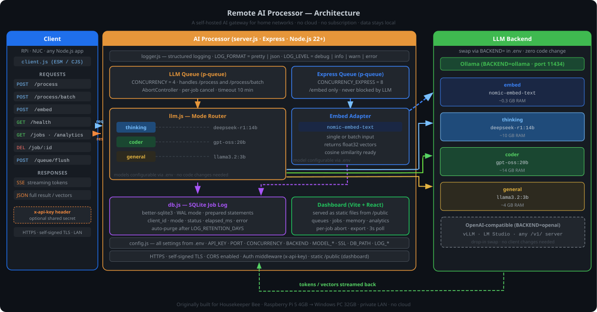
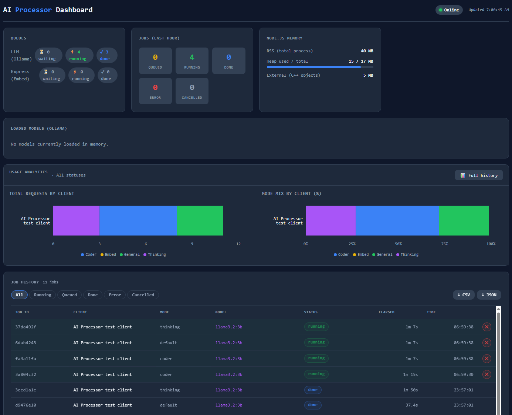

# Remote AI Processor

A self-hosted AI gateway for home networks. Sits above Ollama or any local LLM backend, queues concurrent requests from multiple home devices, and routes them by task type — so every device in your home gets AI access without running its own model, without cloud dependency, and without your data leaving the network.



---

## Features

- **Streaming via SSE** — tokens arrive in real time as the model generates them
- **Batch mode** — single JSON response for integrations that don't need streaming
- **Text embeddings** — vector generation via dedicated fast-path queue
- **Concurrent queue** — configurable LLM + Express queues with p-queue
- **Job cancel / flush** — abort any running or queued job on demand
- **Backend abstraction** — switch between Ollama and any OpenAI-compatible server (vLLM, LM Studio) with one env var
- **SQLite job log** — every job persisted with client ID, model, elapsed time, status
- **React dashboard** — live queue stats, job history with filtering, per-job abort, CSV/JSON export
- **Structured logging** — pretty (dev) or JSON (production) via `LOG_FORMAT`
- **HTTPS** — self-signed TLS for secure LAN use

---

## Requirements

- Node.js 22+
- [Ollama](https://ollama.com) running locally, **or** an OpenAI-compatible server (vLLM, LM Studio)
- At least one model pulled: `ollama pull llama3.2:3b && ollama pull nomic-embed-text`

---

## Installation

### Ubuntu / Raspberry Pi OS

1. **Install Node.js 22+**

```bash
curl -fsSL https://deb.nodesource.com/setup_22.x | sudo -E bash -
sudo apt-get install -y nodejs
node -v   # should print v22.x.x or higher
```

2. **Install build tools** (required by `better-sqlite3`)

```bash
sudo apt-get install -y build-essential
```

3. **Install Ollama**

```bash
curl -fsSL https://ollama.com/install.sh | sh
ollama pull llama3.2:3b
ollama pull nomic-embed-text
```

4. **Clone and configure**

```bash
git clone https://github.com/your-username/remote-ai-processor.git
cd remote-ai-processor/processor
cp .env.example .env
# Edit .env — set PORT, model names, API_KEY, etc.
```

5. **Install dependencies and start**

```bash
npm install
node server.js
```

6. **Allow the port through the firewall**

```bash
sudo ufw allow 3000/tcp
sudo ufw reload
```

Replace `3000` with your `PORT` value if you changed it in `.env`.

---

### Windows 11

1. **Install Node.js 22+**
   - Download the LTS installer from [nodejs.org](https://nodejs.org) and run it.
   - Tick **"Automatically install necessary tools"** during setup — this installs the C++ build tools needed by `better-sqlite3`.
   - Open a new terminal after install and verify: `node -v`

2. **Install Ollama**
   - Download from [ollama.com](https://ollama.com) and run the installer.
   - Open **PowerShell** and pull models:

```powershell
ollama pull llama3.2:3b
ollama pull nomic-embed-text
```

3. **Clone and configure**

```powershell
git clone https://github.com/your-username/remote-ai-processor.git
cd remote-ai-processor\processor
copy .env.example .env
# Edit .env with Notepad or VS Code
```

4. **Install dependencies and start**

```powershell
npm install
node server.js
```

5. **Allow the port through Windows Firewall**

Run PowerShell **as Administrator**:

```powershell
New-NetFirewallRule -DisplayName "Remote AI Processor" `
  -Direction Inbound -Protocol TCP -LocalPort 3000 -Action Allow
```

Replace `3000` with your `PORT` value if changed. This allows other devices on your LAN to reach the processor.

---

## Quick start (existing install)

```bash
cd processor
cp .env.example .env
# Edit .env — set your model names, concurrency, etc.

npm install
node server.js
```

Open `http://localhost:3000` (or `https://localhost:3000` if TLS is configured) for the dashboard.

---

## Troubleshooting

### `npm error gyp ERR! not found: make`

Build tools are missing. Install them:

```bash
# Ubuntu / Raspberry Pi OS
sudo apt-get install -y build-essential

# Windows — re-run the Node.js installer and tick "Automatically install necessary tools",
# or install manually:
npm install --global windows-build-tools
```

### `npm warn deprecated uuid@10`

The `uuid` package is no longer needed — the server uses Node.js built-in `crypto.randomUUID()`. Remove it:

```bash
npm uninstall uuid
```

### Dashboard not reachable from other devices

- Check the firewall rules above for your OS.
- Make sure `HOST=0.0.0.0` is set in `.env` (default). `127.0.0.1` binds to localhost only.
- Confirm Ollama is also accepting connections: `OLLAMA_HOST=0.0.0.0` in Ollama's own config if needed.

### HTTPS certificate errors in browser

The self-signed cert triggers a browser warning on first visit. Click **Advanced → Proceed** (Chrome) or **Accept the Risk** (Firefox). This is expected on a private LAN with no CA.

### Port already in use

```bash
# Linux — find what is using port 3000
sudo lsof -i :3000

# Windows PowerShell
netstat -ano | findstr :3000
```

Change `PORT=` in `.env` to any free port and restart.

---

## HTTPS setup (recommended for LAN use)

```bash
mkdir -p processor/certs
openssl req -x509 -newkey rsa:4096 -keyout processor/certs/server.key \
  -out processor/certs/server.crt -days 3650 -nodes \
  -subj "/CN=localhost"
```

Then set in `.env`:
```env
SSL_KEY_PATH=./certs/server.key
SSL_CERT_PATH=./certs/server.crt
```

---

## Dashboard



The dashboard is a Vite + React app that builds into `processor/public/` and is served as static files.

```bash
cd dashboard
npm install
```

The dashboard shows:
- **Queue panel** — waiting / running / total done for LLM and Express queues
- **Job stats** — counts by status (queued / running / done / error / cancelled)
- **Memory** — RSS and heap usage bars
- **Loaded models** — currently loaded models (Ollama only)
- **Job history** — live table with filter by status, per-job abort, CSV/JSON export
- **Flush button** — cancel everything immediately

---

## API reference

All routes are under `/api/v1/`. Auth: set `API_KEY` in `.env` and pass `x-api-key: <key>` header on every request (or `?apiKey=<key>`). If `API_KEY` is empty, auth is disabled.

### `GET /api/v1/health`

Returns server status, queue counts, loaded models, memory usage.

```json
{
  "status": "ok",
  "backend": "ollama",
  "backendStatus": "ok",
  "queues": {
    "llm":     { "waiting": 0, "running": 2, "total": 47 },
    "express": { "waiting": 0, "running": 0, "total": 312 }
  },
  "jobs": { "queued": 0, "running": 2, "done": 45, "error": 0, "cancelled": 0 },
  "llm": { "models": ["llama3.2:3b", "nomic-embed-text"], "loaded": [...] },
  "memory": { "rss": 128, "heapUsed": 64, "heapTotal": 80, "external": 4 },
  "config": { "concurrency": 4, "concurrencyExpress": 8, "models": {...} }
}
```

> When the backend is unreachable, `status` is `"degraded"` (not an error — the processor stays up).

---

### `POST /api/v1/process` — streaming

**Body:**
```json
{
  "userPrompt":   "Summarise this text: ...",
  "systemPrompt": "You are a helpful assistant.",
  "mode":         "default",
  "model":        "llama3.2:3b",
  "options":      { "temperature": 0.7 }
}
```

`mode` picks the model: `thinking` → `MODEL_THINKING`, `coder` → `MODEL_CODER`, `default` → `MODEL_DEFAULT`. `model` overrides all.

**Response:** `text/event-stream`

```
data: {"type":"queued",    "jobId":"...", "position": 0}
data: {"type":"start",     "jobId":"...", "model":"llama3.2:3b", "mode":"default"}
data: {"type":"token",     "token":"Hello"}
data: {"type":"token",     "token":" world"}
data: {"type":"done",      "jobId":"...", "elapsed": 1234}
```

On error: `{"type":"error","jobId":"...","error":"..."}`.  
On client disconnect or cancel: `{"type":"cancelled","jobId":"..."}`.

**Headers to set on request:**
- `X-Client-Id: my-device` — identifies the caller in job logs

---

### `POST /api/v1/process/batch` — non-streaming

Same body as `/process`. Returns when the full response is ready.

```json
{ "jobId": "...", "result": "Hello world" }
```

Use for slow models or integrations that can't handle SSE.

---

### `POST /api/v1/embed`

```json
{ "input": "text to embed" }
{ "input": ["text one", "text two", "text three"] }
```

```json
{ "jobId": "...", "embeddings": [[0.023, -0.17, ...], ...] }
```

Goes through the Express queue (high concurrency, never blocked by LLM jobs).

---

### `GET /api/v1/jobs`

Paginated job history from SQLite.

| Param | Type | Description |
|---|---|---|
| `status` | string | Filter: `queued` / `running` / `done` / `error` / `cancelled` |
| `clientId` | string | Filter by client ID |
| `model` | string | Filter by model name |
| `since` | string/number | ISO date or ms timestamp |
| `page` | number | Page number (default 1) |
| `pageSize` | number | Results per page (default 50, max 200) |

```json
{ "jobs": [...], "total": 1234, "page": 1, "pageSize": 50 }
```

### `GET /api/v1/jobs/stats?days=7`

```json
{
  "period": "7d",
  "total": 312, "done": 298, "error": 3, "cancelled": 11,
  "avgElapsedMs": 4210,
  "uniqueClients": 2,
  "uniqueModels": 3
}
```

### `DELETE /api/v1/job/:id`

Cancel a queued or running job. Returns `{"cancelled":true}` or HTTP 404/409.

### `POST /api/v1/queue/flush`

Cancel all queued and running jobs immediately.

---

## Backend switching

### Ollama (default)

```env
BACKEND=ollama
OLLAMA_URL=http://localhost:11434
```

### OpenAI-compatible (vLLM, LM Studio)

```env
BACKEND=openai
OPENAI_URL=http://localhost:8000
OPENAI_API_KEY=                   # leave empty for local servers
```

No code change needed. The processor routes all calls through the same `llm.js` interface.

---

## Production logging

```env
LOG_FORMAT=json
LOG_LEVEL=info
```

Each line is a JSON object — pipe to any log aggregator:

```bash
node server.js 2>&1 | tee processor.log
```

```json
{"ts":"2026-11-19T10:23:45.123Z","level":"info","msg":"server ready","url":"https://0.0.0.0:3000","backend":"ollama"}
{"ts":"2026-11-19T10:23:52.001Z","level":"info","msg":"job start","jobId":"...","model":"llama3.2:3b","mode":"default","clientId":"rpi-kitchen"}
{"ts":"2026-11-19T10:23:56.812Z","level":"info","msg":"job done","jobId":"...","elapsedMs":4811}
```

---

## Integrating with your own Node.js app

Copy `client/client.js` into your app and add three lines to your `.env`:

```env
AI_PROCESSOR_URL=https://192.168.1.100:3000
AI_PROCESSOR_KEY=your-api-key        # leave empty if auth is disabled
CLIENT_ID=your-app-name              # identifies this app in the dashboard
```

Then import and call:

```js
import { processPromptBatch, embedText } from './client.js';

const answer  = await processPromptBatch({ userPrompt: 'Hello' });
const vectors = await embedText({ input: 'some text' });
```

**ESM** (`"type": "module"` in `package.json`) — works as-is.

**CommonJS** (`require`) — rename the file to `client.mjs` and use a dynamic import:

```js
const { processPromptBatch, embedText } = await import('./client.mjs');
```

See **[client-README.md](./client-README.md)** for the full API reference, all options, and examples.

---

## Run as a service (systemd)

```ini
# /etc/systemd/system/ai-processor.service
[Unit]
Description=Remote AI Processor
After=network.target

[Service]
Type=simple
User=pi
WorkingDirectory=/home/pi/remote-ai-processor/processor
EnvironmentFile=/home/pi/remote-ai-processor/processor/.env
ExecStart=/usr/bin/node server.js
Restart=on-failure
RestartSec=5

[Install]
WantedBy=multi-user.target
```

```bash
sudo systemctl enable --now ai-processor
sudo journalctl -u ai-processor -f
```
